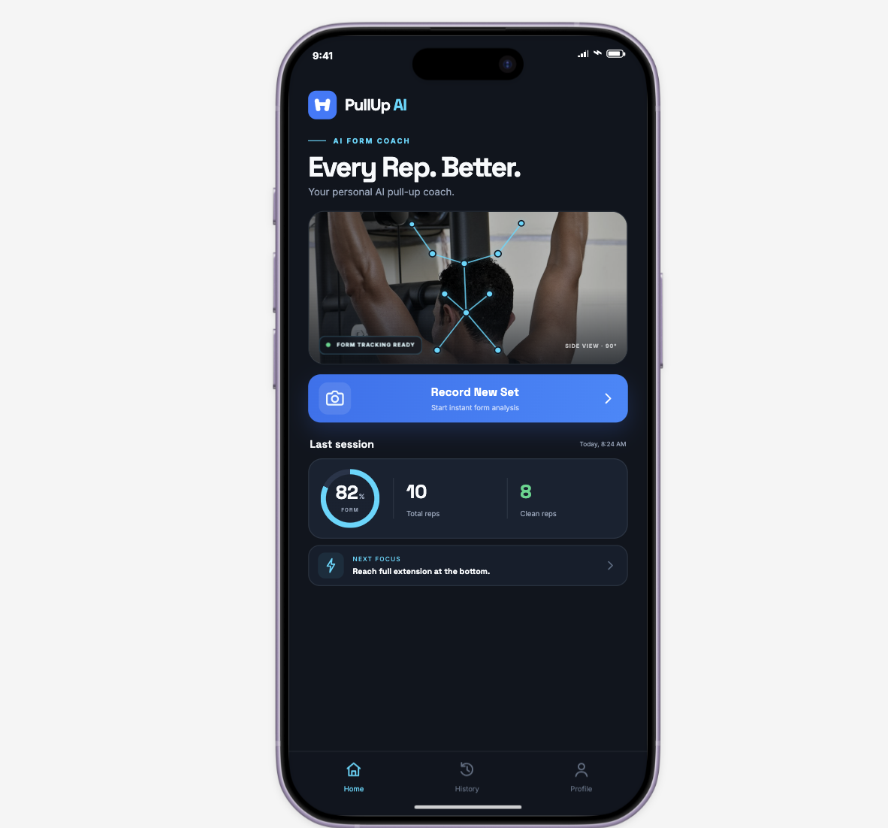

# PullUp AI

**Every Rep. Better.**

PullUp AI is a mobile app prototype for gym club members who want to improve their pull-up technique. Its one core job is simple: **record a set of pull-ups and get instant visual form feedback.**

### [Try the interactive prototype](https://cube-dot-30106217.figma.site)

## What it does

- **Record a set:** Follow camera positioning instructions and enter a simulated recording flow.
- **Review form:** See example feedback on technique, including clean repetitions, a form score, and suggested corrections.
- **Track sessions:** Explore session history and progress summaries.
- **View profile:** Access personal statistics and settings, including useful empty states for new users.

## Prototype walkthrough

1. Open the **Home** screen and select **Record New Set**.
2. Review the camera setup instructions.
3. Continue to the simulated pull-up recording screen.
4. Finish the set to view the form analysis.
5. Visit **History** or **Profile** using the bottom navigation.

## Design

The interface uses deep navy backgrounds, electric-blue actions, cyan tracking overlays, clear typography, and high-contrast feedback cards. The primary recording action remains prominent on mobile screens.

## Project links

- **Live clickable prototype:** https://cube-dot-30106217.figma.site
- **Figma Community design:** https://www.figma.com/community/file/1703180446941177757/pullup-ai

## Current status

**Interactive UX prototype — not a production fitness-analysis application.** The recording, pose-tracking visualization, form scores, and feedback are simulated for usability testing. No real camera-based pose detection or AI model is claimed to be running in this prototype.

## Next steps

- Implement camera capture and permission handling.
- Integrate pose estimation and repetition segmentation.
- Validate form criteria against expert-labeled exercise videos.
- Add accessible, privacy-conscious session storage.

---

Designed by **Samarah Hiba** as a mobile app prototyping project.
